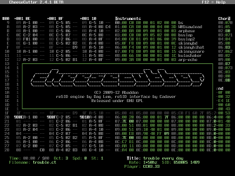

# CheeseCutter-EXTended

A tracker-style music editor for the Commodore 64 SID chip — an EXTended fork of
CheeseCutter 2.9 by Abaddon.



## Features

- reSID / reSID-fp playback, 6581 and 8580 SID models, PAL and NTSC timing.
- Tracker sequencer with rectangular block selection across voices — copy, cut,
  paste, merge and "paste as new track(s)" in both the note (F6) and track (F5)
  columns.
- Dropdown menu bar (`Esc`) and a type-to-search command palette; every command
  is reachable from the menus, all driven by a single shortcut registry (which
  also generates `F12` help and `doc/KEYBOARD.md`).
- Export to C64 `.prg` (full player or optimized) and PSID `.sid`, plus offline
  audio render to `.wav` / `.flac` with normalize, bit depth and sample-rate
  options.
- Instrument color tags (`$X` / `$XY`) in instrument descriptions.
- Read-only **filter track** column in the pattern view (between voice 3 and the
  instrument table): per-row SID filter registers (cutoff, resonance, mode and a
  per-channel routing mask) derived by tracing the song, color-coded by whether a
  value is taken straight from the filter table or calculated by a sweep. Toggle
  with `Ctrl-Shift-F`.
- Hardware and emulator playback (C64 Ultimate, VICE), switchable at runtime from
  **File → Properties** along with the Ultimate IP/port, `x64sc` path and SDL
  audio driver — persisted to a JSON preferences file in the per-OS config dir.
- Configurable colors via a JSON palette: redefine the 16 base colors and assign
  them to semantic UI **roles** (background, cursor, frame, playbackBar, …). Load
  `palette.json` from the config dir automatically, or point `--palette <file>`
  at your own; defaults reproduce the classic C64 colors. See
  [`doc/palette.json`](doc/palette.json).
- Companion `ct2util` CLI for headless convert / export / merge / dump.

See the [user guide](guide/README.md) for details on every feature.

## Documentation

- **User guide** — [`guide/README.md`](guide/README.md) (also prepared for
  GitHub Pages deployment).
- **In-app help** — press `F12`.
- **Keyboard reference** — [`doc/KEYBOARD.md`](doc/KEYBOARD.md) (generated).

## Building

See **[`doc/BUILD.md`](doc/BUILD.md)** for the full macOS / Linux / Windows
guide. Quick start on macOS:

```sh
./bootstrap.sh                                      # install deps + test build
mise run build                                      # or build directly:
make -f Makefile.mac LIBSPATH="$(brew --prefix)/lib"
```

## Credits

Programmed by Abaddon 2009-2017.

Mac OSX and D2 port by Ruk 2013.

reSID engine by Dag Lem & A. Lankila.

Parts of reSID interface (sid.cpp) by Cadaver / CovertBitops.

Includes Acme Assembler 0.91 by Marco Baye.

libSDL by the SDL team.

derelict, http://www.dsource.org/projects/derelict

Special thanks to Vent/Triad, Blackspawn, Mr Ammo, Scarzix/Offence,
SuperNoise, Wisdom/Crescent and the forgotten ones...

## License

Licensed under the GNU General Public License (see [`LICENSE.md`](LICENSE.md)).

Binary packages are available for some distributions via
https://repology.org/metapackage/cheesecutter/versions — the authors of
CheeseCutter-EXTended take no responsibility for binaries downloaded from any
third-party website, including the one above.
